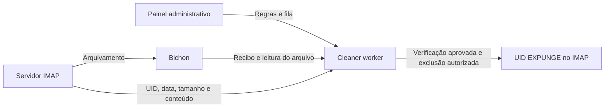

# Bichon Cleaner

Painel administrativo e worker para liberar espaço no servidor IMAP, excluindo mensagens antigas **somente depois de verificar sua cópia arquivada no Bichon**.

> **Dependência obrigatória: [Bichon](https://github.com/rustmailer/bichon) com a integração de recibos de arquivamento descrita neste repositório. Este projeto não funciona sozinho. O código dessa extensão do Bichon não está incluído aqui; uma instalação oficial sem esse endpoint não basta.**

O Cleaner exclui no **servidor de e-mail de origem**. O arquivo no Bichon é preservado. A operação usa `UID EXPUNGE`: é uma exclusão definitiva, sem mover para a lixeira.

## Funcionalidades

- Regras globais, por conta e por pastas, com seleção múltipla e exceções.
- Criar, editar, ativar, pausar e excluir regras.
- Simulação e liberação da exclusão real com senha do administrador do Bichon.
- Verificações repetidas, idade mínima do arquivo e comparação BLAKE3 da mensagem original.
- Execução agendada ou solicitada pelo painel; processamento em lotes por pasta.
- Contadores, histórico de exclusões confirmadas e exportação CSV.
- Acesso ao painel restrito a usuários do Bichon com `system:root`.

## Como funciona



“Mais de 12 meses” inclui mensagens de qualquer ano anterior ao limite calculado. A data usada é `INTERNALDATE` do IMAP. Uma mensagem encontrada na busca não está automaticamente autorizada para exclusão.

## Instalação e uso

Requer Linux com systemd, Python 3.12 ou superior, acesso local ao armazenamento e à chave de criptografia do Bichon e servidor IMAP com UIDPLUS. OAuth e proxy IMAP não são suportados por este worker.

1. Confira o [contrato de integração com o Bichon](docs/bichon-integration.md).
2. Siga a [instalação](docs/installation.md).
3. Crie uma regra no painel e ative a simulação.
4. Confira os relatórios. Para excluir, libere a exclusão com senha e solicite uma execução.

Veja [operação, regras e diagnóstico](docs/operations.md) e [segurança](SECURITY.md).

## Desenvolvimento

```bash
python -m unittest discover -p 'test_*.py' -v
python -m py_compile worker.py dashboard.py
```

Os testes usam serviços simulados; não acessam caixas nem validam criptografia real. A validação de integração deve ocorrer em uma caixa de teste com cópia recuperável. Não execute o worker real em uma estação de desenvolvimento com credenciais de produção.

## Organização

| Arquivo | Responsabilidade |
| --- | --- |
| `worker.py` | Política, validação do arquivo, IMAP e auditoria |
| `dashboard.py` | Autenticação administrativa, regras e relatórios |
| `test_*.py` | Testes de regras, controles de acesso e proteções IMAP |
| `deploy/` | Serviços, timer e acionamento imediato com systemd |
| `config/*.example.json` | Exemplos inativos, sem dados reais |

Este repositório contém o código do Cleaner, não o Bichon, seus arquivos de e-mail ou as alterações no servidor de arquivamento. Projeto independente, sem afiliação oficial com o Bichon. O Bichon possui licença própria, indicada no [repositório de origem](https://github.com/rustmailer/bichon). Não foi atribuída uma licença de redistribuição ao código do Cleaner neste repositório privado.
